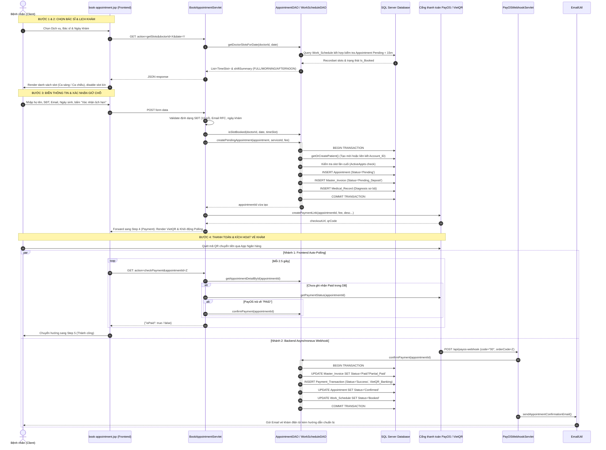
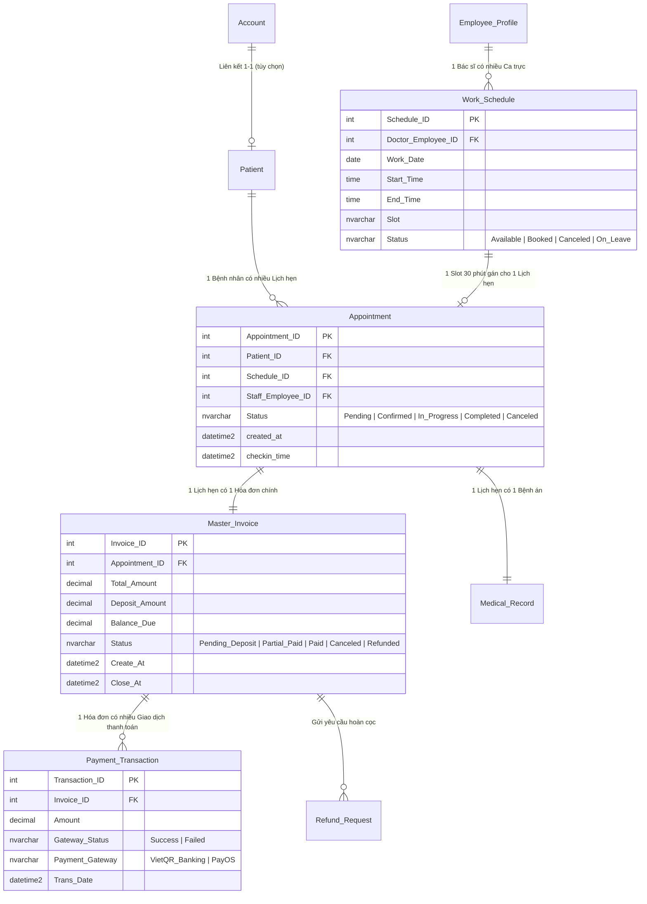

# TÀI LIỆU KỸ THUẬT & HƯỚNG DẪN BẢO VỆ PHÂN HỆ
# ĐẶT LỊCH KHÁM & TÍCH HỢP THANH TOÁN (ONLINE BOOKING & PAYMENT INTEGRATION)

---

## THÔNG TIN DỰ ÁN & PHÂN HỆ
- **Dự án**: Hệ thống quản lý phòng khám chuyên khoa mắt **VisionCare** (SWP Project).
- **Phân hệ phụ trách**: Đặt lịch khám trực tuyến & Tích hợp cổng thanh toán (Online Appointment Booking & Payment Integration).
- **Công nghệ sử dụng**:
  - **Backend**: Java Servlet (Jakarta EE), JDBC Driver, Java Mail API, PayOS SDK / REST API Client.
  - **Database**: Microsoft SQL Server (Transaction Isolation, Constraints, Foreign Keys).
  - **Frontend**: JSP (JavaServer Pages), JSTL, Vanilla JavaScript (Fetch API, DOM manipulation), CSS3 Custom Variables, Bootstrap Icons.
  - **Tích hợp bên thứ ba (Third-party integrations)**:
    - **VietQR API**: Tạo mã QR thanh toán nhanh theo chuẩn NAPAS 247.
    - **PayOS Payment Gateway**: Cổng thanh toán trực tuyến, hỗ trợ Webhook và Open API kiểm tra trạng thái đơn hàng.

---

## MỤC LỤC
1. [Tổng quan mục tiêu & Kiến trúc hệ thống](#1-tổng-quan-mục-tiêu--kiến-trúc-hệ-thống)
2. [Sơ đồ luồng toàn trình (End-to-End Sequence & Workflow)](#2-sơ-đồ-luồng-toàn-trình-end-to-end-sequence--workflow)
3. [Phân tích nghiệp vụ chi tiết từng bước (Step-by-Step Business Logic)](#3-phân-tích-nghiệp-vụ-chi-tiết-từng-bước-step-by-step-business-logic)
4. [Phân tích chi tiết mã nguồn theo mô hình MVC (Code Walkthrough)](#4-phân-tích-chi-tiết-mã-nguồn-theo-mô-hình-mvc-code-walkthrough)
5. [Cơ sở dữ liệu: Thiết kế, Quan hệ thực thể & Transaction ACID](#5-cơ-sở-dữ-liệu-thiết-kế-quan-hệ-thực-thể--transaction-acid)
6. [Các giải pháp kỹ thuật nâng cao (Key Engineering Solutions)](#6-các-giải-pháp-kỹ-thuật-nâng-cao-key-engineering-solutions)
7. [Bảo mật, Kiểm soát lỗi & Ngoại lệ (Security & Error Handling)](#7-bảo-mật-kiểm-soát-lỗi--ngoại-lệ-security--error-handling)
8. [Kịch bản thuyết trình bảo vệ 3 phút (Elevator Pitch)](#8-kịch-bản-thuyết-trình-bảo-vệ-3-phút-elevator-pitch)
9. [Bộ câu hỏi phản biện của Hội đồng / Tech Lead & Câu trả lời mẫu](#9-bộ-câu-hỏi-phản-biện-của-hội-đồng--tech-lead--câu-trả-lời-mẫu)

---

## 1. TỔNG QUAN MỤC TIÊU & KIẾN TRÚC HỆ THỐNG

### 1.1. Mục tiêu nghiệp vụ
1. **Trải nghiệm đặt lịch trực tuyến mượt mà**: Cho phép bệnh nhân tìm kiếm dịch vụ khám, chọn bác sĩ theo chuyên khoa, tra cứu các khung giờ làm việc thực tế và đặt lịch trong vòng dưới 2 phút.
2. **Khóa slot chống trùng lịch (Anti Double-Booking)**: Tuyệt đối không cho phép 2 bệnh nhân đặt trùng một bác sĩ tại cùng một khung giờ khám 30 phút.
3. **Thanh toán giữ chỗ thông minh (Deposit Holding)**: Áp dụng cơ chế thanh toán giữ chỗ trực tuyến (100% phí khám dịch vụ ban đầu) qua VietQR / PayOS để hạn chế tối đa tỷ lệ "đặt ảo" (No-Show Rate). Phí này được khấu trừ vào viện phí hoặc ca phẫu thuật sau này.
4. **Tự động hóa toàn trình (Full Automation)**: Tự động cập nhật trạng thái đơn hàng khi tiền về tài khoản thông qua Webhook / Polling, tự động phát hành vé khám điện tử và gửi email xác nhận.

### 1.2. Kiến trúc giải pháp (Architecture Stack)
```
+-------------------------------------------------------------------------------+
|                             CLIENT / BROWSER                                  |
|   JSP Wizard UI  <--->  JavaScript Engine (Fetch API, Polling Loop, DOM)     |
+-------------------------------------------------------------------------------+
                                      | HTTP Request / JSON
                                      v
+-------------------------------------------------------------------------------+
|                       CONTROLLER LAYER (SERVLET)                              |
|   BookAppointmentServlet   |   PayOSWebhookServlet   | AppointmentCancelServlet|
+-------------------------------------------------------------------------------+
                                      |
         +----------------------------+----------------------------+
         v                                                         v
+------------------------------------+    +------------------------------------+
|         SERVICE / DAO LAYER        |    |       THIRD-PARTY INTEGRATION      |
|  AppointmentDAO   | WorkScheduleDAO|    |  PayOSUtil (REST, HMAC-SHA256)     |
|  DoctorDAO        | CatalogDAO     |    |  EmailUtil (JavaMail SMTP)         |
+------------------------------------+    +------------------------------------+
         |                                                         |
         v JDBC (Transaction ACID)                                 v
+------------------------------------+    +------------------------------------+
|       SQL SERVER DATABASE          |    |         PAYOS GATEWAY / VIETQR     |
| (Appointment, Work_Schedule,       |    | (QR Generation, Webhook Callback,  |
|  Master_Invoice, Medical_Record...) |    |  Payment Status Verification)      |
+------------------------------------+    +------------------------------------+
```

---

## 2. SƠ ĐỒ LUỒNG TOÀN TRÌNH (END-TO-END SEQUENCE & WORKFLOW)



---

## 3. PHÂN TÍCH NGHIỆP VỤ CHI TIẾT TỪNG BƯỚC (STEP-BY-STEP BUSINESS LOGIC)

Quy trình đặt lịch được thiết kế theo mô hình **Wizard 4 bước + 1 bước kết quả**:

### Bước 1: Chọn Chuyên khoa & Bác sĩ
- Bệnh nhân có thể lọc bác sĩ theo chuyên khoa hoặc theo dịch vụ.
- Giao diện có tính năng tự động liên kết (Bi-directional Binding):
  - Khi chọn một Gói dịch vụ (ví dụ: *Phẫu thuật khúc xạ Femto-LASIK*), hệ thống tự động lọc danh sách chỉ hiển thị các bác sĩ thuộc chuyên khoa Khúc xạ.
  - Ngược lại, nếu chọn bác sĩ trước, dịch vụ tương ứng với chuyên môn của bác sĩ sẽ được tự động kích hoạt.

### Bước 2: Chọn Ngày & Khung giờ khám (Dynamic Real-time Slot Loading)
- Bệnh nhân chọn ngày khám trên lịch (chỉ cho phép chọn từ ngày hiện tại trở đi, tối đa trước 30 ngày).
- Trình duyệt phát tín hiệu AJAX `action=getSlots`:
  - Hệ thống truy vấn toàn bộ ca trực trong ngày của bác sĩ.
  - Tự động phân loại ca làm việc: `FULL` (làm cả sáng và chiều), `MORNING` (chỉ ca sáng), `AFTERNOON` (chỉ ca chiều), `OFF` (nghỉ).
  - Tự động loại bỏ hoàn toàn các slot buổi tối (sau 17h30) theo quy định vận hành của phòng khám mắt.
  - Mỗi khung giờ khám có thời lượng chuẩn **30 phút**.
  - Các slot đã có người đặt (`Confirmed`) hoặc đang có người giữ chỗ thanh toán (`Pending` dưới 15 phút) sẽ bị khóa (disable) và hiển thị nhãn *"Đã kín"*.

### Bước 3: Xác thực thông tin bệnh nhân & Tính biểu phí
- Yêu cầu đăng nhập: Bắt buộc người dùng đăng nhập để định danh tài khoản, tránh spam lịch ảo. Nếu chưa đăng nhập, hệ thống ghi nhớ đường dẫn quay lại (`redirectAfterLogin`) và chuyển sang trang login.
- Form yêu cầu: Họ tên, Số điện thoại (kiểm tra regex 10 số Việt Nam `^0[35789]\d{8}$`), Email tiếp nhận vé khám, Ngày sinh, Mô tả triệu chứng ban đầu.
- Tính toán phí dịch vụ: 
  - Toàn bộ chi phí khám dịch vụ được tính làm phí cọc giữ chỗ 100% (`Deposit_Amount`).
  - Đối với các gói khám chuyên sâu hoặc khám tiền phẫu, hệ thống ghi chú rõ: *Chi phí khám được khấu trừ 100% vào chi phí ca mổ nếu bệnh nhân thực hiện phẫu thuật*.

### Bước 4: Thanh toán giữ chỗ (VietQR & PayOS Integration)
- Khi bấm "Xác nhận lịch hẹn", hệ thống tạo lịch hẹn ở trạng thái `Pending` và tạo hóa đơn `Pending_Deposit`.
- Hệ thống render mã VietQR động chuẩn EMVCo kèm mã chuyển khoản định dạng: `VC<Appointment_ID> <Số_Điện_Thoại>`.
- Đồng thời gọi API PayOS tạo `checkoutUrl` chính thức.
- Cơ chế kiểm tra thanh toán kép (Dual Verification):
  - **Cơ chế 1 (Frontend Auto-Polling)**: JavaScript gửi request định kỳ mỗi 2.5 giây kiểm tra trạng thái đơn.
  - **Cơ chế 2 (Backend Webhook)**: Cổng PayOS bắn callback về webhook khi phát hiện biến động số dư.
  - **Cơ chế 3 (Manual Verification)**: Nút "Tôi đã chuyển khoản" cho phép gọi trực tiếp Open API của PayOS để xác thực tức thì.

### Bước 5: Hoàn tất & Cấp vé khám (Success & Electronic Ticket)
- Sau khi thanh toán xác nhận:
  - Lịch hẹn chuyển sang trạng thái `Confirmed`.
  - Khung giờ trực của bác sĩ chuyển thành `Booked`.
  - Hóa đơn chuyển thành `Paid` (hoặc `Partial_Paid` nếu có số dư nợ sau này).
  - Giao diện cấp Vé khám điện tử (Appointment Ticket) hiển thị: Mã lịch khám (`#APT-xxx`), Bác sĩ phụ trách, Phòng khám, Giờ tiếp đón và Hướng dẫn trước khi đến khám.
  - Email thông báo tự động gửi về hòm thư bệnh nhân qua JavaMail SMTP.

---

## 4. PHÂN TÍCH CHI TIẾT MÃ NGUỒN THEO MÔ HÌNH MVC (CODE WALKTHROUGH)

### 4.1. Tầng Controller
- **`BookAppointmentServlet.java`**:
  - `doGet`:
    - Dòng 41–67: Xử lý AJAX `checkPayment`. Kiểm tra trạng thái trong DB; nếu DB chưa cập nhật mà PayOS API xác nhận `PAID`, chủ động gọi `confirmPayment()` ngay lập tức.
    - Dòng 137–174: Xử lý AJAX `getSlots`. Trả về JSON khung giờ động theo bác sĩ và ngày.
    - Dòng 176–190: Kiểm tra xác thực phiên đăng nhập (Authentication Filter logic).
    - Dòng 192–272: Chuẩn bị danh mục và xử lý tham số điều hướng (`selectedDoctorId`, `selectedServiceId`).
  - `doPost`:
    - Dòng 295–382: Nhánh `confirmPayment`. Người dùng bấm xác nhận thủ công, kiểm tra trực tiếp qua `PayOSUtil.getPaymentStatus(appointmentId)`.
    - Dòng 384–456: Bóc tách dữ liệu từ form và gán vào model `Appointment`.
    - Dòng 458–488: Server-side Validation nghiêm ngặt (Tên, SĐT, Email, Bác sĩ, Ngày khám, Khung giờ).
    - Dòng 490–499: Double-check tính khả dụng của slot bằng `appointmentDAO.isSlotBooked()`.
    - Dòng 522: Gọi `appointmentDAO.createPendingAppointment(appointment, serviceId, fee)`.
    - Dòng 530–554: Tạo chuỗi VietQR chuẩn và gọi PayOS SDK sinh payment link.

- **`PayOSWebhookServlet.java`**:
  - Lắng nghe sự kiện thanh toán từ PayOS tại URL `/api/payos-webhook`.
  - Đọc Payload JSON từ `request.getReader()`.
  - Trích xuất `orderCode` (chính là `Appointment_ID`).
  - Gọi `appointmentDAO.confirmPayment(appointmentId)` để cập nhật dữ liệu đa bảng trong Transaction.
  - Gọi `EmailUtil.sendAppointmentConfirmationEmail(...)` gửi email thông báo vé khám.

- **`AppointmentCancelServlet.java`**:
  - Phân luồng xử lý:
    - Nếu lịch ở trạng thái `Pending` (chưa thanh toán): Cho phép hủy trực tiếp qua `appointmentDAO.cancelAppointment(...)`, hoàn trả slot về `Available` và hủy hóa đơn.
    - Nếu lịch ở trạng thái `Confirmed` (đã thanh toán cọc): Chuyển sang quy trình gửi yêu cầu duyệt hủy qua `appointmentDAO.requestCancelAppointment(...)` và tạo bản ghi trong `Refund_Request` để nhân viên Lễ tân / Kế toán duyệt hoàn tiền.

### 4.2. Tầng Data Access Object (DAO)

- **`AppointmentDAO.java`**:
  - `createPendingAppointment(Appointment a, int serviceId, long fee)`:
    - Sử dụng `conn.setAutoCommit(false)` để mở Database Transaction.
    - Gọi `getOrCreatePatient(conn, a)`: Kiểm tra bệnh nhân theo số điện thoại hoặc Account_ID; nếu chưa có thì thêm mới, nếu đã có tài khoản thì liên kết `Account_ID`.
    - Kiểm tra xung đột slot thời gian thực:
      ```sql
      SELECT ws.Status, 
             (SELECT COUNT(*) FROM Appointment ap WHERE ap.Schedule_ID = ws.Schedule_ID 
              AND (ap.Status IN ('Confirmed', 'In_Progress', 'Completed') 
                   OR (ap.Status = 'Pending' AND DATEDIFF(MINUTE, ap.created_at, SYSUTCDATETIME()) < 15))) AS ActiveAppts 
      FROM Work_Schedule ws WHERE ws.Schedule_ID = ?
      ```
      Nếu `Status == 'Booked'` hoặc `ActiveAppts > 0` $\rightarrow$ Thực hiện `conn.rollback()` và trả về `-1`.
    - `INSERT INTO Appointment` với trạng thái `'Pending'`.
    - `INSERT INTO Master_Invoice` với trạng thái `'Pending_Deposit'`.
    - `INSERT INTO Medical_Record` lưu chẩn đoán lý do khám ban đầu.
    - `conn.commit()` và trả về `Appointment_ID`.
  - `confirmPayment(int appointmentId)`:
    - Mở Transaction cập nhật:
      1. Cập nhật `Master_Invoice`: `Deposit_Amount`, `Balance_Due`, chuyển status sang `'Paid'` (hoặc `'Partial_Paid'`).
      2. Ghi nhật ký vào `Payment_Transaction`: `Gateway_Status = 'Success'`, `Payment_Gateway = 'VietQR_Banking'`.
      3. Cập nhật `Appointment`: Chuyển status sang `'Confirmed'`.
      4. Cập nhật `Work_Schedule`: Chuyển status sang `'Booked'`.
      5. `conn.commit()`.
  - `cancelAppointment(int appointmentId, String reason)`:
    - Cập nhật `Appointment.Status = 'Canceled'`.
    - Cập nhật `Work_Schedule.Status = 'Available'` (giải phóng slot ngay).
    - Cập nhật `Master_Invoice.Status = 'Canceled'`.
    - Ghi nhận lý do hủy vào `Medical_Record.conclusion`.
  - `autoCancelExpiredAppointments()`:
    - Quét và tự động hủy các lịch `Pending` quá hạn khám mà chưa check-in.

- **`WorkScheduleDAO.java`**:
  - `getDoctorSlotsForDate(int doctorId, String dateStr)`:
    - Truy vấn danh sách slot làm việc của bác sĩ.
    - Áp dụng logic điều kiện:
      - Loại bỏ ca tối (`CAST(Start_Time AS TIME) < '17:30:00'`).
      - Tính toán trường `Is_Booked`: nếu ca trực đã `Booked` hoặc có lịch `Confirmed` / `Pending` (< 15 phút) thì đánh dấu `1`, ngược lại là `0`.
    - Gán phiên làm việc `Morning` (trước 12:00) hoặc `Afternoon` (sau 12:00).
  - `getDoctorWorkShiftSummary(int doctorId, String dateStr)`:
    - Tổng hợp thông tin ca làm việc để trả về badge ca trực: `FULL`, `MORNING`, `AFTERNOON` hoặc `OFF`.

### 4.3. Tầng Frontend (JSP & JavaScript)
- **`book-appointment.jsp`**:
  - Giao diện Wizard 4 bước trực quan, responsive tương thích thiết bị di động.
  - Sử dụng JSTL (`c:if`, `c:forEach`, `fmt:formatNumber`) kết hợp JavaScript để hiển thị trạng thái động.
  - Bộ hàm xử lý Wizard: `nextWizardStep(step)`, `prevWizardStep(step)`, `jumpToWizardStep(step)`.
  - Cơ chế **Auto-Polling Loop**:
    ```javascript
    const checkInterval = setInterval(function () {
      pollAttempts++;
      if (pollAttempts > 180) { // Quá 15 phút tự động dừng
        clearInterval(checkInterval);
        return;
      }
      fetch(contextPath + '/book-appointment?action=checkPayment&appointmentId=' + currentApptId)
        .then(res => res.json())
        .then(data => {
          if (data && data.isPaid) {
            clearInterval(checkInterval);
            window.location.href = contextPath + '/book-appointment?step=success&id=' + currentApptId;
          }
        });
    }, 2500); // 2.5s / lần
    ```

---

## 5. CƠ SỞ DỮ LIỆU: THIẾT KẾ, QUAN HỆ THỰC THỂ & TRANSACTION ACID

### 5.1. Sơ đồ thực thể liên quan (Entity Relationship Diagram)



### 5.2. Các ràng buộc toàn vẹn dữ liệu (Constraints)
1. **Ràng buộc Slot 30 phút**:
   `ALTER TABLE Work_Schedule ADD CONSTRAINT CHK_WS_Slot_30Mins CHECK (DATEDIFF(MINUTE, Start_Time, End_Time) = 30);`
2. **Ràng buộc trạng thái Lịch hẹn**:
   `ALTER TABLE Appointment ADD CONSTRAINT CHK_Appt_Status CHECK (Status IN (N'Pending', N'Confirmed', N'In_Progress', N'Completed', N'Canceled'));`
3. **Ràng buộc tiền cọc và dư nợ**:
   - `Deposit_Amount <= Total_Amount`
   - `Balance_Due <= Total_Amount`
   - `Balance_Due = Total_Amount - Deposit_Amount`

### 5.3. Bảng chuyển đổi trạng thái (State Transition Matrix)

| Trạng thái nghiệp vụ | `Appointment.Status` | `Master_Invoice.Status` | `Work_Schedule.Status` | Mô tả chi tiết |
| :--- | :--- | :--- | :--- | :--- |
| **Khởi tạo form** | Chưa có bản ghi | Chưa có bản ghi | `Available` | Khung giờ đang mở tự do |
| **Bấm xác nhận (Giữ chỗ)** | `Pending` | `Pending_Deposit` | `Available` *(soft lock 15m)* | Khóa mềm 15 phút chờ chuyển khoản |
| **Thanh toán thành công** | `Confirmed` | `Paid` / `Partial_Paid` | `Booked` | Khóa cứng vĩnh viễn, phát hành vé khám |
| **Check-in tại phòng khám** | `Confirmed` (có checkin_time)| Giữ nguyên | `Booked` | Lễ tân tiếp đón, xếp số thứ tự khám |
| **Bác sĩ đang khám** | `In_Progress` | Giữ nguyên | `Booked` | Bác sĩ thực hiện khám chuyên khoa |
| **Hoàn tất khám bệnh** | `Completed` | `Paid` | `Booked` | Đã khám xong, xuất đơn thuốc |
| **Hủy lịch hẹn** | `Canceled` | `Canceled` | `Available` | Giải phóng slot để người khác đặt |

---

## 6. CÁC GIẢI PHÁP KỸ THUẬT NÂNG CAO (KEY ENGINEERING SOLUTIONS)

### 6.1. Xử lý xung đột & Chống Double-Booking (Concurrency Control)
- **Vấn đề**: Nhiều bệnh nhân cùng chọn một bác sĩ tại cùng một khung giờ và cùng nhấn xác nhận.
- **Giải pháp**:
  - Áp dụng cơ chế **Khóa mềm 15 phút (15-minute Sliding Window)**: Ngay khi bệnh nhân đầu tiên nhấn xác nhận, một bản ghi `Appointment` trạng thái `Pending` được tạo.
  - Câu truy vấn kiểm tra slot sử dụng điều kiện:
    `OR (ap.Status = 'Pending' AND DATEDIFF(MINUTE, ap.created_at, SYSUTCDATETIME()) < 15)`
  - Bệnh nhân thứ hai khi kiểm tra sẽ thấy slot đã bị chiếm và bị chặn ngay lập tức.
  - Nếu sau 15 phút bệnh nhân đầu tiên không thanh toán, điều kiện trên tự động trả về `false`, giải phóng slot cho người khác mà không cần can thiệp thủ công.
  - Kết hợp với **JDBC Transaction Level**, nếu 2 request đến cùng mili-giây, request nào commit trước sẽ thành công, request thứ hai đọc lại thấy slot không còn khả dụng và tự động rollback.

### 6.2. Kiến trúc xác thực thanh toán kép (Dual Verification)
- **Vấn đề**: Mạng di động của người dùng không ổn định, người dùng có thể đóng ứng dụng hoặc tắt trình duyệt ngay sau khi chuyển khoản thành công trên app ngân hàng.
- **Giải pháp**:
  - **Webhook (Asynchronous Push)**: Cổng thanh toán gọi trực tiếp Server-to-Server qua `/api/payos-webhook`. Đảm bảo ngay cả khi người dùng tắt máy, vé khám vẫn được kích hoạt và email vẫn được gửi.
  - **Auto-Polling (Synchronous Pull)**: Trình duyệt liên tục thăm dò trạng thái mỗi 2.5 giây. Đảm bảo trải nghiệm tức thì: người dùng vừa chuyển khoản xong trên điện thoại thì màn hình máy tính tự động nhảy sang vé thành công.
  - **Idempotency (Tính bất biến khi gọi lặp lại)**: Hàm `confirmPayment()` được thiết kế sao cho dù Webhook và Polling cùng gọi đồng thời, dữ liệu chỉ được cập nhật đúng 1 lần duy nhất, không tạo giao dịch trùng lặp.

### 6.3. Tự động liên kết danh tính người dùng (`getOrCreatePatient`)
- Khi một người dùng đã đăng nhập tài khoản thực hiện đặt lịch:
  - Hệ thống kiểm tra xem số điện thoại đã từng có hồ sơ bệnh nhân trong bảng `Patient` chưa.
  - Nếu đã có nhưng trước đây chưa liên kết với tài khoản (`Account_ID IS NULL`), hệ thống tự động cập nhật liên kết `Account_ID`.
  - Giúp đồng bộ toàn bộ lịch sử khám bệnh cũ vào tài khoản người dùng mà không tạo bản ghi bệnh nhân trùng lặp.

---

## 7. BẢO MẬT, KIỂM SOÁT LỖI & NGOẠI LỆ (SECURITY & ERROR HANDLING)

1. **Bảo vệ xác thực (Authentication Enforcement)**:
   - Toàn bộ luồng đặt lịch yêu cầu session hợp lệ. Người dùng chưa đăng nhập được chuyển hướng an toàn về `/login` kèm tham số lưu vết URL để quay lại sau khi đăng nhập thành công.
2. **Server-side Validation & Chống giả mạo tham số (Tampering Prevention)**:
   - Không tin tưởng dữ liệu từ client: Toàn bộ giá tiền dịch vụ (`totalAmount`, `depositFee`) được truy vấn lại trực tiếp từ Database thông qua `CatalogDAO` theo `serviceId`, ngăn chặn việc sửa giá từ F12 / DevTools.
   - Kiểm tra định dạng số điện thoại Việt Nam chuẩn 10 chữ số đầu mạng hợp lệ (`03x`, `05x`, `07x`, `08x`, `09x`).
   - Kiểm tra định dạng Email chuẩn RFC.
3. **Bảo vệ toàn vẹn Webhook (Webhook Signature Security)**:
   - Payload Webhook được ký bằng chữ ký số HMAC-SHA256 thông qua secret key của PayOS, đảm bảo chỉ có PayOS chính chủ mới có thể kích hoạt thanh toán.
4. **Quản lý Transaction an toàn**:
   - Mọi phương thức ghi DB nhạy cảm đều có cấu trúc:
     ```java
     try {
         conn.setAutoCommit(false);
         // Thực hiện các thao tác
         conn.commit();
     } catch (Exception e) {
         if (conn != null) conn.rollback();
         throw e;
     } finally {
         if (conn != null) {
             conn.setAutoCommit(true);
             conn.close();
         }
     }
     ```

---

## 8. KỊCH BẢN THUYẾT TRÌNH BẢO VỆ 3 PHÚT (ELEVATOR PITCH)

> *"Kính thưa Thầy/Cô và các anh/chị trong Hội đồng đánh giá,*
> 
> *Em xin đại diện nhóm trình bày về phân hệ trọng tâm của dự án VisionCare: **Phân hệ Đặt lịch khám trực tuyến & Tích hợp cổng thanh toán (Online Booking & Payment Integration)**.*
> 
> *Về mặt nghiệp vụ, phân hệ này giải quyết bài toán đặt lịch khám mắt khép kín theo tiêu chuẩn phòng khám hiện đại: từ việc tra cứu dịch vụ, bác sĩ chuyên khoa, hiển thị các khung giờ khám 30 phút theo thời gian thực đến việc thanh toán đặt cọc giữ chỗ và phát hành vé khám điện tử.*
> 
> *Về mặt kỹ thuật, phân hệ được em xây dựng theo mô hình **MVC chuẩn Java EE**, kết nối SQL Server thông qua cơ chế **JDBC Transaction Management**. Phân hệ đạt được 3 điểm sáng công nghệ nổi bật:*
> 
> *Thứ nhất là **Cơ chế chống Double-Booking & Race Condition**: Hệ thống áp dụng thuật toán khóa mềm 15 phút (15-minute sliding window) kết hợp Transaction Isolation. Khi một bệnh nhân đang tiến hành thanh toán, khung giờ đó sẽ lập tức được khóa đối với tất cả người dùng khác, triệt tiêu hoàn toàn rủi ro trùng lịch.*
> 
> *Thứ hai là **Kiến trúc thanh toán kép kết hợp VietQR & PayOS**: Em tích hợp song song cơ chế **Webhook bất đồng bộ** từ phía Server và **Auto-Polling thời gian thực** từ phía Client. Sự kết hợp này mang lại trải nghiệm người dùng tức thì (giao diện tự động chuyển trạng thái thành công sau 2 giây khi tiền về tài khoản), đồng thời đảm bảo an toàn dữ liệu 100% ngay cả khi bệnh nhân bị mất kết nối mạng sau khi chuyển khoản.*
> 
> *Thứ ba là **Tính toàn vẹn dữ liệu (ACID)**: Quá trình tạo hồ sơ bệnh nhân, lập hóa đơn cọc, mở bệnh án lâm sàng sơ bộ và khóa ca trực của bác sĩ được đóng gói trong một Database Transaction duy nhất, đảm bảo tính nhất quán tuyệt đối của hệ thống.*
> 
> *Sau đây, em xin phép được trình diễn trực tiếp luồng nghiệp vụ trên hệ thống và phân tích chi tiết mã nguồn..."*

---

## 9. BỘ CÂU HỎI PHẢN BIỆN CỦA HỘI ĐỒNG / TECH LEAD & CÂU TRẢ LỜI MẪU

### Câu 1: Làm thế nào nếu 2 người cùng bấm đặt cùng 1 bác sĩ ở cùng 1 khung giờ vào đúng 1 giây?
- **Trả lời**:
  > *"Hệ thống kiểm soát qua 2 lớp phòng vệ:*
  > *1. **Lớp Pre-check**: Trước khi tạo lịch, hàm `isSlotBooked()` kiểm tra nếu đã có lịch `Confirmed` hoặc lịch `Pending` còn hiệu lực dưới 15 phút thì chặn ngay từ tầng ứng dụng.*
  > *2. **Lớp Database Transaction**: Trong hàm `createPendingAppointment()`, em sử dụng `conn.setAutoCommit(false)`. Ngay khi bắt đầu transaction, query kiểm tra `ActiveAppts` được thực thi. Do SQL Server áp dụng cơ chế khóa hàng (Row-level lock), giao dịch nào ghi trước sẽ hoàn tất, giao dịch thứ hai đọc dữ liệu thấy `ActiveAppts > 0` sẽ lập tức nhảy vào nhánh `conn.rollback()` và trả về mã lỗi thông báo khung giờ vừa có người giữ chỗ."*

---

### Câu 2: Tại sao lại vừa dùng Webhook vừa dùng AJAX Polling? Dùng 1 cái có được không?
- **Trả lời**:
  > *"Dạ được, nhưng việc kết hợp cả hai là tiêu chuẩn thiết kế tốt nhất cho hệ thống thanh toán thực tế (Production Best Practice):*
  > *- Nếu chỉ dùng Polling: Phụ thuộc hoàn toàn vào trình duyệt người dùng. Nếu khách chuyển khoản xong trên điện thoại mà máy tính bị tắt hoặc rớt mạng, giao dịch sẽ bị treo và không bao giờ được kích hoạt trong DB.*
  > *- Nếu chỉ dùng Webhook: Webhook là giao tiếp Server-to-Server, phía client (trình duyệt) sẽ không biết khi nào Webhook hoàn tất để tự động đổi màn hình sang trang vé khám thành công trừ khi khách hàng tự bấm F5 lại trang.*
  > *- Vì vậy, **Webhook đóng vai trò chốt chặn dữ liệu an toàn**, còn **Polling đóng vai trò nâng cao trải nghiệm người dùng tức thời**. Hàm `confirmPayment()` được thiết kế theo nguyên lý Idempotent nên dù cả 2 cùng gọi cũng không bao giờ bị ghi nhận tiền 2 lần."*

---

### Câu 3: Làm sao ngăn chặn người dùng cố tình đặt giữ chỗ ảo nhiều lần để làm nghẽn lịch khám của bác sĩ?
- **Trả lời**:
  > *"Dạ, hệ thống áp dụng 3 tầng kiểm soát:*
  > *1. Bắt buộc phải **đăng nhập tài khoản** mới được thực hiện đặt lịch, ngăn chặn hoàn toàn khách vãng lai (Anonymous) spam request.*
  > *2. Ràng buộc thời gian giữ chỗ nghiêm ngặt chỉ trong **15 phút**. Hết 15 phút không thanh toán, slot tự động mở lại mà không cần chạy cron job.*
  > *3. Hệ thống có cơ chế kiểm tra lịch sử đặt lịch; nếu một tài khoản có tỷ lệ hủy/quá hạn cao bất thường, Admin hoặc Lễ tân có thể khóa tài khoản (`Account_Status = 'Banned'` hoặc `'Locked'`)."*

---

### Câu 4: Tại sao lại tách riêng bảng `Master_Invoice` mà không lưu số tiền trực tiếp trong bảng `Appointment`?
- **Trả lời**:
  > *"Dạ, việc tách riêng bảng `Master_Invoice` tuân thủ nguyên tắc chuẩn hóa dữ liệu và phản ánh đúng nghiệp vụ tài chính y tế:*
  > *- Bảng `Appointment` chỉ đại diện cho việc **hẹn giờ gặp bác sĩ**.*
  > *- Trong thực tế khám chữa bệnh, một đợt khám phát sinh nhiều khoản thu: tiền cọc khám ban đầu (`Deposit_Amount`), các chỉ định chụp chiếu xét nghiệm phát sinh sau đó (`Procedure_Order`), và tiền thuốc (`Prescription`).*
  > *- Tách `Master_Invoice` giúp quản lý dòng tiền độc lập: ghi nhận `Total_Amount`, `Deposit_Amount`, và tính toán `Balance_Due` (tiền còn nợ phải thu thêm tại quầy) mà không làm ô nhiễm bảng lịch hẹn; đồng thời cho phép liên kết 1-N với bảng lịch sử thanh toán (`Payment_Transaction`) và bảng yêu cầu hoàn tiền (`Refund_Request`)."*

---

### Câu 5: Nếu người dùng đã thanh toán cọc thành công nhưng sau đó bận việc muốn hủy lịch thì quy trình xử lý thế nào?
- **Trả lời**:
  > *"Dạ, hệ thống phân biệt 2 kịch bản trong `AppointmentCancelServlet`:*
  > *- **Trường hợp 1 - Lịch chưa thanh toán cọc (Pending)**: Bệnh nhân được phép hủy trực tiếp; hệ thống lập tức chuyển `Appointment.Status = 'Canceled'` và hoàn trả trạng thái ca trực `Work_Schedule.Status = 'Available'` để người khác đặt ngay.*
  > *- **Trường hợp 2 - Lịch đã thanh toán cọc (Confirmed)**: Bệnh nhân không thể tự hủy ngay để tránh rủi ro gian lận hoàn tiền. Hệ thống sẽ tạo một bản ghi `Refund_Request` ở trạng thái `Pending` gửi lên bộ phận Lễ tân và Kế toán. Sau khi nhân viên kiểm tra lý do và xác nhận chuyển khoản hoàn cọc, trạng thái lịch hẹn mới chính thức được chuyển sang hủy."*

---

### Câu 6: Làm thế nào hệ thống đảm bảo giá tiền dịch vụ không bị can thiệp thay đổi từ phía Client (F12 / DevTools)?
- **Trả lời**:
  > *"Dạ, hệ thống áp dụng nguyên tắc **Zero Trust đối với dữ liệu phía Client**: Phía client chỉ gửi lên `serviceId`. Trong `BookAppointmentServlet.java`, server sẽ gọi `catalogDAO.getService(serviceId)` để lấy giá niêm yết trực tiếp từ Database. Giá tiền gửi sang cổng PayOS và lưu vào `Master_Invoice` hoàn toàn được tính toán từ dữ liệu phía Server, client không thể can thiệp sửa đổi số tiền cần thanh toán."*

---

### Câu 7: Hệ thống xử lý thế nào khi thời gian khám của một ca bị kéo dài hơn 30 phút?
- **Trả lời**:
  > *"Dạ, 30 phút là thời lượng ước tính tiêu chuẩn của một slot khám nhãn khoa tổng quát ban đầu. Khi bệnh nhân đến phòng khám và check-in, Lễ tân xếp bệnh nhân vào danh sách hàng đợi (Queue). Khi bác sĩ gọi khám, trạng thái lịch chuyển sang `In_Progress`. Nếu ca khám phức tạp cần làm thêm cận lâm sàng, bác sĩ sẽ tạo các `Procedure_Order`, bệnh nhân di chuyển sang các phòng kỹ thuật để thực hiện và sau đó quay lại phòng bác sĩ kết luận mà không làm gián đoạn lịch tiếp đón của các ca khám cơ bản tiếp theo."*

---

### Câu 8: Cơ chế tự động dọn dẹp các lịch khám hết hạn (`autoCancelExpiredAppointments`) hoạt động như thế nào?
- **Trả lời**:
  > *"Dạ, hàm `autoCancelExpiredAppointments()` trong `AppointmentDAO` thực hiện quét các lịch có trạng thái `Pending` mà chưa có `checkin_time`, thuộc các ca trực có ngày khám nhỏ hơn ngày hiện tại, hoặc là ngày hôm nay nhưng đã quá giờ kết thúc ca khám (`End_Time <= Giờ_Hiện_Tại`). Các lịch này tự động chuyển sang `Canceled` và ghi chú lý do vào bệnh án: 'Quá giờ hẹn nhưng bệnh nhân không đến check-in'."*

---

### Câu 9: Trong trường hợp cổng PayOS gặp sự cố không kết nối được, hệ thống có giải pháp dự phòng (Fallback) nào?
- **Trả lời**:
  > *"Dạ có, hệ thống được thiết kế theo cơ chế High Availability Fallback:*
  > *- Song song với link thanh toán PayOS, hệ thống luôn tự động render mã VietQR tiêu chuẩn trực tiếp từ hình ảnh VietQR API với đầy đủ cú pháp nội dung chuyển khoản và số tài khoản chính của phòng khám.*
  > *- Bệnh nhân vẫn có thể dùng bất kỳ ứng dụng ngân hàng nào để quét mã VietQR chuyển khoản bình thường.*
  > *- Tại quầy Lễ tân, nhân viên có màn hình quản lý lịch hẹn (`StaffAppointmentListServlet`) với đầy đủ chức năng tra cứu biến động số dư và bấm nút 'Xác nhận thanh toán thủ công' để kích hoạt vé khám cho bệnh nhân."*

---

### Câu 10: Nếu được nâng cấp hệ thống trong tương lai, bạn sẽ cải tiến thêm những điểm gì cho phân hệ này?
- **Trả lời**:
  > *"Dạ, nếu có thêm thời gian phát triển cho phiên bản tiếp theo, em sẽ nâng cấp 3 điểm:*
  > *1. Triển khai **Redis Distributed Lock** để tối ưu hóa hiệu năng khóa slot ở mức micro-second thay vì hoàn toàn phụ thuộc vào locking của cơ sở dữ liệu quan hệ.*
  > *2. Áp dụng **WebSocket (STOMP / SockJS)** thay thế cho HTTP Polling để biến luồng kiểm tra thanh toán thành giao tiếp 2 chiều hoàn toàn theo thời gian thực (Full Real-time Push).*
  > *3. Tích hợp tính năng **Tự động nhắc lịch qua Zalo ZNS / SMS OTP** trước giờ khám 2 tiếng để giảm thiểu hơn nữa tỷ lệ quên lịch hẹn của người bệnh."*
