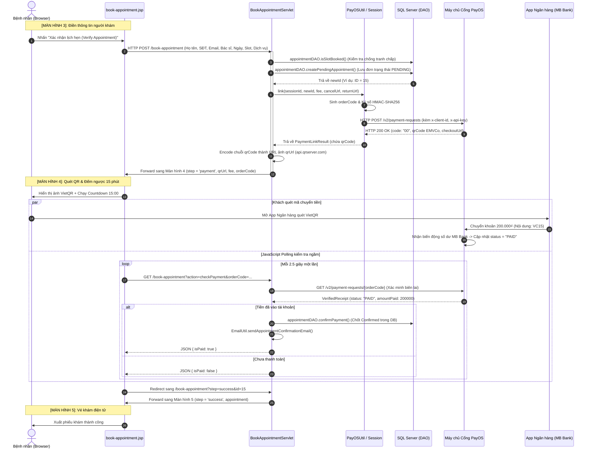

# TÀI LIỆU KỸ THUẬT: QUY TRÌNH TÍCH HỢP PAYOS & VIETQR TRONG ĐẶT LỊCH KHÁM MẮT VISIONCARE

> **Dự án:** Hệ thống Quản trị Phòng khám Mắt VisionCare (SWP391)  
> **Module phụ trách:** Đặt lịch trực tuyến (Online Booking) & Tích hợp Cổng thanh toán VietQR  
> **Người thực hiện:** TrungND  
> **Cập nhật:** Tháng 11/2026

---

## MỤC LỤC
1. [Kiến Trúc Tổng Thể & Sơ Đồ Tuần Tự (Sequence Diagram)](#1-kiến-trúc-tổng-thể--sơ-đồ-tuần-tự)
2. [Bản Chất Công Nghệ: Vì Sao Cần Cả VietQR Lẫn PayOS?](#2-bản-chất-công-nghệ-vì-sao-cần-cả-vietqr-lẫn-payos)
3. [Chi Tiết 5 Giai Đoạn Vòng Đời Mã QR (Kèm Code & Vị Trí Dòng)](#3-chi-tiết-5-giai-đoạn-vòng-đời-mã-qr)
   - [Giai đoạn 1: Submit Form Màn 3 $\rightarrow$ Tạo đơn Pending & Sinh chuỗi VietQR](#giai-đoạn-1-tạo-lịch-hẹn-pending--sinh-mã-vietqr-màn-hình-3)
   - [Giai đoạn 2: Màn 4 Render ảnh QR & Khởi chạy đếm ngược 15:00](#giai-đoạn-2-hiển-thị-vietqr--đếm-ngược-giữ-chỗ-15-phút-màn-hình-4)
   - [Giai đoạn 3: Cơ chế kép Kiểm tra thanh toán (Check Payment)](#giai-đoạn-3-kiểm-tra-trạng-thái-thanh-toán-check-payment)
   - [Giai đoạn 4: Xác thực thành công $\rightarrow$ Chốt DB, gửi Email & Xuất vé khám](#giai-đoạn-4-thanh-toán-thành-công--chuyển-sang-màn-hình-5)
   - [Giai đoạn 5: Xử lý Hủy giữ chỗ hoặc Hết hạn 15 phút](#giai-đoạn-5-xử-lý-hủy-giữ-chỗ-hoặc-hết-hạn-15-phút)
4. [Bảng Tra Cứu Nhanh Các File & Hàm Quan Trọng](#4-bảng-tra-cứu-nhanh-các-file--hàm-quan-trọng)
5. [Bộ Câu Hỏi Phản Biện Của Hội Đồng & Đáp Án Mẫu](#5-bộ-câu-hỏi-phản-biện-của-hội-đồng--đáp-án-mẫu)

---

## 1. KIẾN TRÚC TỔNG THỂ & SƠ ĐỒ TUẦN TỰ



---

## 2. BẢN CHẤT CÔNG NGHỆ: VÌ SAO CẦN CẢ VIETQR LẪN PAYOS?

Nhiều người thường nhầm lẫn giữa **VietQR** và **PayOS**. Dưới đây là phân định kỹ thuật rõ ràng:

| Đặc điểm | VIETQR (Napas) | CỔNG PAYOS (Open Banking) |
| :--- | :--- | :--- |
| **Bản chất** | Chuẩn định dạng ảnh mã QR quốc gia của Việt Nam (tiêu chuẩn EMVCo). | Cổng thanh toán trung gian kết nối trực tiếp với Core Banking ngân hàng (MB Bank). |
| **Chức năng** | Giúp bệnh nhân quét trên App ngân hàng để **tự điền số tài khoản, số tiền và nội dung `VC15`** mà không cần gõ tay. | Tự động "bắt" biến động số dư tài khoản ngân hàng và **báo ngay cho Website biết tiền đã vào hay chưa**. |
| **Nếu KHÔNG có?** | Bệnh nhân phải nhập tay STK, số tiền, cú pháp $\rightarrow$ Rất dễ gõ nhầm tiền hoặc nhầm mã hẹn. | Web hoàn toàn "mù", không biết khách đã chuyển tiền chưa. Phải có lễ tân ngồi xem sao kê điện thoại rồi duyệt tay thủ công. |
| **Sự kết hợp** | **Giao diện thân thiện** cho người bệnh quét mã. | **Bộ não tự động hóa** kiểm tra và kích hoạt vé khám trong 1 giây. |

---

## 3. CHI TIẾT 5 GIAI ĐOẠN VÒNG ĐỜI MÃ QR

---

### GIAI ĐOẠN 1: TẠO LỊCH HẸN PENDING & SINH MÃ VIETQR (MÀN HÌNH 3)

Khi người dùng ở Màn hình 3 điền xong thông tin và bấm **"Xác nhận lịch hẹn (Verify Appointment)"**, form gửi `POST /book-appointment`.

#### 1.1. Ghi nhận lịch hẹn `Pending` (Chờ thanh toán) vào CSDL
* **File:** `src/java/com/visioncare/controller/BookAppointmentServlet.java` — **Dòng 507**
```java
// Tạo lịch hẹn trạng thái 'Chờ thanh toán' (Pending) trong SQL Server, nhận về newId
int newId = appointmentDAO.createPendingAppointment(appointment, serviceId, fee);
```

#### 1.2. Khởi tạo mã đơn hàng duy nhất (`orderCode`)
* **File:** `src/java/com/visioncare/controller/BookAppointmentServlet.java` — **Dòng 517**
```java
// Sinh mã đơn hàng duy nhất trên cổng PayOS (kết hợp ID lịch hẹn + micro-timestamp)
long orderCode = ((long) newId * 1000000L) + (System.currentTimeMillis() / 1000L % 1000000L);
request.getSession().setAttribute("payos_order_" + newId, orderCode);
```

#### 1.3. Ký số bảo mật HMAC-SHA256 & Bắn HTTP POST sang API PayOS
* **File:** `src/java/com/visioncare/util/PayOSUtil.java` — **Dòng 101 - 131**
```java
// Sắp xếp các tham số theo bảng chữ cái A-Z và băm với CHECKSUM_KEY bí mật
String signData = "amount=" + amount + "&cancelUrl=" + cancelUrl + "&description=" + description + "&orderCode=" + orderCode + "&returnUrl=" + returnUrl;
String signature = hmacSHA256(signData, CHECKSUM_KEY);

// Gửi HTTP POST sang máy chủ PayOS
HttpRequest request = HttpRequest.newBuilder()
        .uri(URI.create(ENDPOINT + "/v2/payment-requests"))
        .header("Content-Type", "application/json; charset=UTF-8")
        .header("x-client-id", CLIENT_ID)
        .header("x-api-key", API_KEY)
        .POST(HttpRequest.BodyPublishers.ofString(jsonBody, StandardCharsets.UTF_8))
        .build();

HttpResponse<String> response = client.send(request, HttpResponse.BodyHandlers.ofString(StandardCharsets.UTF_8));
String respBody = response.body();
```

#### 1.4. PayOS trả về `code == "00"`, bóc tách chuỗi VietQR Napas
* **File:** `src/java/com/visioncare/util/PayOSUtil.java` — **Dòng 134 - 140**
```java
String code = extractJsonField(respBody, "code");
if ("00".equals(code)) {
    result.success = true;
    result.checkoutUrl = extractJsonField(respBody, "checkoutUrl");
    result.qrCode = extractJsonField(respBody, "qrCode"); // Chuỗi EMVCo Napas (0002010102123854...)
    result.paymentLinkId = extractJsonField(respBody, "paymentLinkId");
    result.status = extractJsonField(respBody, "status");
}
```

#### 1.5. Chuyển chuỗi `qrCode` thành ảnh VietQR và Forward sang Màn hình 4
* **File:** `src/java/com/visioncare/controller/BookAppointmentServlet.java` — **Dòng 531 - 565**
```java
// Biến chuỗi qrCode text thành link ảnh mã QR
if (payosRes.qrCode != null && !payosRes.qrCode.isEmpty()) {
    qrUrl = "https://api.qrserver.com/v1/create-qr-code/?size=300x300&data=" 
            + URLEncoder.encode(payosRes.qrCode, StandardCharsets.UTF_8);
}

// Đóng gói request attributes và FORWARD sang JSP
request.setAttribute("qrUrl", qrUrl);
request.setAttribute("step", "payment");
request.setAttribute("pendingHoldMinutes", 15);
request.getRequestDispatcher("/views/appointment/book-appointment.jsp").forward(request, response);
```

---

### GIAI ĐOẠN 2: HIỂN THỊ VIETQR & ĐẾM NGƯỢC GIỮ CHỖ 15 PHÚT (MÀN HÌNH 4)

Giao diện Màn hình 4 kích hoạt khi điều kiện `<c:if test="${step == 'payment'}">` thỏa mãn.

#### 2.1. Render ảnh mã QR VietQR động và thông tin chuyển khoản
* **File:** `web/views/appointment/book-appointment.jsp` — **Dòng 1018 - 1055**
```html
<!-- Thẻ hiển thị mã QR động chứa sẵn tiền và nội dung chuyển khoản -->


<!-- Bảng chi tiết chuyển khoản -->
<div class="col-6 text-muted">Ngân hàng:</div><div class="col-6 fw-bold text-end">${bankName}</div>
<div class="col-6 text-muted">Số tài khoản:</div><div class="col-6 fw-bold text-end">${accountNumber}</div>
<div class="col-6 text-muted">Nội dung chuyển khoản:</div><div class="col-6 fw-bold text-danger text-end"><code>${paymentDesc}</code></div>
```

#### 2.2. Khởi tạo đồng hồ đếm ngược 15:00 và thanh thời gian giữ chỗ
* **File:** `web/views/appointment/book-appointment.jsp` — **Dòng 1024 - 1032 & Dòng 2100 - 2132**
```html
<span class="fs-5 fw-bold text-danger font-monospace" id="paymentCountdownTimer">15:00</span>
<div class="progress" style="height: 6px;">
  <div id="countdownProgressBar" class="progress-bar bg-danger" style="width: 100%;"></div>
</div>
```
```javascript
// Cứ mỗi 1 giây cập nhật thời gian còn lại, đổi màu thanh progress (Xanh -> Vàng -> Đỏ khẩn cấp)
function updatePaymentCountdown() {
    const remainingMs = expireTimestamp - Date.now();
    const remainingSec = Math.max(0, Math.floor(remainingMs / 1000));
    // Hiển thị định dạng mm:ss lên màn hình
    ...
}
```

---

### GIAI ĐOẠN 3: KIỂM TRA TRẠNG THÁI THANH TOÁN (CHECK PAYMENT)

Hệ thống triển khai cơ chế kiểm tra kép để bảo đảm bệnh nhân không bị kẹt màn hình:

#### 3.1. Frontend tự động Polling AJAX mỗi 2.5 giây lên Server
* **File:** `web/views/appointment/book-appointment.jsp` — **Dòng 2185 - 2197**
```javascript
// Gửi request ngầm hỏi Server mỗi 2.5 giây
checkInterval = setInterval(function () {
    fetch('${pageContext.request.contextPath}/book-appointment?action=checkPayment&appointmentId=' + currentApptId + '&orderCode=${orderCode}')
      .then(res => res.json())
      .then(data => {
          if (data && data.isPaid) {
              clearInterval(checkInterval);
              clearInterval(countdownInterval);
              sessionStorage.removeItem(storageKey);
              // Tự động chuyển thẳng sang Màn hình 5 thành công
              window.location.href = '${pageContext.request.contextPath}/book-appointment?step=success&id=' + currentApptId;
          }
      });
}, 2500);
```

#### 3.2. Khách bấm nút chủ động "Tôi đã chuyển khoản" (Dự phòng)
* **File:** `web/views/appointment/book-appointment.jsp` — **Dòng 1090 - 1095**
```html
<form method="post" action="${pageContext.request.contextPath}/book-appointment">
  <input type="hidden" name="action" value="confirmPayment">
  <input type="hidden" name="appointmentId" value="${appointment.id}">
  <input type="hidden" name="orderCode" value="${orderCode}">
  <button type="submit" class="btn btn-success btn-lg fw-bold">
    <i class="bi bi-shield-check me-2"></i>Tôi đã chuyển khoản (Kiểm tra thanh toán)
  </button>
</form>
```

#### 3.3. Backend gọi sang PayOS lấy biên lai thực tế từ Ngân hàng
* **File:** `src/java/com/visioncare/controller/BookAppointmentServlet.java` — **Dòng 675 (hoặc 748)**
```java
// Gọi sang máy chủ PayOS tra cứu trực tiếp theo orderCode
com.visioncare.util.PayOSUtil.VerifiedReceipt receipt = com.visioncare.util.PayOSUtil.getVerifiedReceipt(orderCode);
```

#### 3.4. So khớp trạng thái: `status == "PAID"` và số tiền thanh toán $\ge$ tiền cọc
* **File:** `src/java/com/visioncare/controller/BookAppointmentServlet.java` — **Dòng 676 (hoặc 751)**
```java
if (com.visioncare.util.BookingPaymentSession.matches(apptId, orderCode, appt.getFee(), receipt)) {
    // Đã thanh toán đầy đủ tiền cọc qua ngân hàng -> chuyển sang Giai đoạn 4
}
```

---

### GIAI ĐOẠN 4: THANH TOÁN THÀNH CÔNG $\rightarrow$ CHUYỂN SANG MÀN HÌNH 5

#### 4.1. Cập nhật Database sang `Confirmed` (Khóa chống cướp slot)
* **File:** `src/java/com/visioncare/controller/BookAppointmentServlet.java` — **Dòng 677 (hoặc 758)**
```java
// Cập nhật trạng thái lịch hẹn: Status = 'Confirmed', isDepositPaid = 1 (Dùng khóa UPDLOCK, HOLDLOCK)
if (!appointmentDAO.confirmPayment(apptId)) {
    throw new IllegalStateException("Lịch hẹn không còn hợp lệ hoặc bác sĩ bận đột xuất.");
}
```

#### 4.2. Gửi Email vé khám điện tử & Dặn dò y khoa
* **File:** `src/java/com/visioncare/controller/BookAppointmentServlet.java` — **Dòng 694 - 703**
```java
EmailUtil.sendAppointmentConfirmationEmail(
    email.trim(),
    fullAppt.getPatientName(),
    fullAppt.getId(),
    fullAppt.getDoctorName(),
    fullAppt.getDepartment(),
    fullAppt.getAppointmentDate().toString(),
    fullAppt.getTimeSlot(),
    fullAppt.getFee()
);
```

#### 4.3. Phía Frontend nhận `isPaid = true` và chuyển sang Màn hình 5
* **File:** `web/views/appointment/book-appointment.jsp` — **Dòng 2193**
```javascript
window.location.href = '${pageContext.request.contextPath}/book-appointment?step=success&id=' + currentApptId;
```

#### 4.4. Hiển thị Vé khám điện tử `#VC{id}` chính thức trên giao diện
* **File:** `web/views/appointment/book-appointment.jsp` — **Dòng 1159 - 1200**
```html
<c:if test="${step == 'success'}">
  <h2 class="fw-bold text-success mb-2">Đặt Lịch &amp; Thanh Toán Thành Công!</h2>
  <h4 class="fw-bold text-teal mb-0">#VC${appointment.id}</h4>
  <span class="badge bg-success px-3 py-2 fs-6 rounded-pill">
    <i class="bi bi-shield-check me-1"></i>ĐÃ XÁC NHẬN &amp; THANH TOÁN
  </span>
  <!-- Chi tiết bệnh nhân, bác sĩ, ngày hẹn, slot giờ, viện phí đã thanh toán -->
</c:if>
```

---

### GIAI ĐOẠN 5: XỬ LÝ HỦY GIỮ CHỖ HOẶC HẾT HẠN 15 PHÚT

Hệ thống có 3 tầng bảo vệ để giải phóng slot cho người khác, không để slot bị giữ ảo:

#### 5.1. Khách bấm nút "Hủy và chọn lại lịch khác"
* **File:** `web/views/appointment/book-appointment.jsp` — **Dòng 1102**
```html
<a href="${pageContext.request.contextPath}/book-appointment?action=cancelPending&id=${appointment.id}" class="btn btn-link text-muted">
  <i class="bi bi-arrow-left me-1"></i>Hủy và chọn lại lịch khác
</a>
```

#### 5.2. Servlet giải phóng slot khám trong CSDL khi hủy
* **File:** `src/java/com/visioncare/controller/BookAppointmentServlet.java` — **Dòng 797 - 811** (Hàm `handleCancelPending`)
```java
int apptId = Integer.parseInt(apptIdStr);
appointmentDAO.cancelAppointment(apptId, "Bệnh nhân hủy trước khi thanh toán để chọn lịch khác");
response.sendRedirect(request.getContextPath() + "/book-appointment");
```

#### 5.3. Đồng hồ về 00:00 (Hết 15 phút), JavaScript tự động gọi API hủy
* **File:** `web/views/appointment/book-appointment.jsp` — **Dòng 2160 - 2165**
```javascript
if (remainingSec <= 0) {
    clearInterval(countdownInterval);
    if (checkInterval) clearInterval(checkInterval);
    sessionStorage.removeItem(storageKey);

    // Tự động gọi API hủy slot trên Database ngay lập tức
    fetch('${pageContext.request.contextPath}/book-appointment?action=cancelPending&format=json&id=' + encodeURIComponent(currentApptId));
}
```

#### 5.4. Khóa nút thanh toán, hiển thị cảnh báo hết hạn trên màn hình
* **File:** `web/views/appointment/book-appointment.jsp` — **Dòng 2168 - 2172 & Dòng 1108 - 1118**
```javascript
document.getElementById('paymentActionArea').classList.add('d-none');   // Ẩn nút thanh toán
document.getElementById('paymentExpiredArea').classList.remove('d-none'); // Hiện cảnh báo hết hạn
```
```html
<div id="paymentExpiredArea" class="d-none text-center">
  <h5 class="fw-bold text-danger mb-1">Mã QR đã hết hạn thanh toán (Quá 15 phút)</h5>
  <a href="${pageContext.request.contextPath}/book-appointment" class="btn btn-primary rounded-pill">
    Đặt lại lịch hẹn mới
  </a>
</div>
```

#### 5.5. Dọn dẹp tự động trên Server (Hủy đơn quá 15 phút bị bỏ quên)
* **File:** `src/java/com/visioncare/controller/BookAppointmentServlet.java` — **Dòng 309**
```java
// Bất cứ khi nào có người tra cứu danh sách slot (action=getSlots), hệ thống tự động quét hủy đơn quá hạn
appointmentDAO.autoCancelExpiredPendingAppointments();
```

---

## 4. BẢNG TRA CỨU NHANH CÁC FILE & HÀM QUAN TRỌNG

| Tên File | Chức năng chính | Hàm / Đoạn code trọng tâm |
| :--- | :--- | :--- |
| `BookAppointmentServlet.java` | Router điều hướng HTTP GET & POST toàn bộ 5 màn hình | • `handleCreatePendingAppointmentPost` (Dòng 343)<br>• `handlePaymentView` (Dòng 577)<br>• `handleCheckPayment` (Dòng 653)<br>• `handleConfirmPaymentPost` (Dòng 724)<br>• `handleCancelPending` (Dòng 797)<br>• `handleSuccessView` (Dòng 817) |
| `PayOSUtil.java` | Tích hợp thư viện API của PayOS, ký HMAC và parse JSON | • `createPaymentLink()` (Dòng 89)<br>• `getVerifiedReceipt()` (Dòng 220)<br>• `hmacSHA256()` (Dòng 60)<br>• `extractJsonField()` (Dòng 244) |
| `BookingPaymentSession.java` | Quản lý phiên giữ chỗ, tái sử dụng orderCode khi F5 | • `link()` (Dòng 12)<br>• `matches()` (Dòng 43) |
| `AppointmentDAO.java` | Tương tác trực tiếp với bảng `Appointments` trong CSDL | • `createPendingAppointment()`<br>• `confirmPayment()` (Transaction lock)<br>• `cancelAppointment()`<br>• `autoCancelExpiredPendingAppointments()` |
| `book-appointment.jsp` | Giao diện hiển thị tuần tự 5 màn hình và logic JavaScript | • Màn 3 Form: Dòng 816<br>• Màn 4 QR & Countdown: Dòng 993<br>• Màn 5 Vé khám: Dòng 1159<br>• Countdown & Polling JS: Dòng 2100 - 2197 |

---

## 5. BỘ CÂU HỎI PHẢN BIỆN CỦA HỘI ĐỒNG & ĐÁP ÁN MẪU

#### ❓ Câu hỏi 1: Nếu khách hàng quét QR xong, đóng luôn trình duyệt thì hệ thống có ghi nhận không?
> **Trả lời:** *"Dạ có ạ! Vì biến động số dư được PayOS và Ngân hàng MB ghi nhận trên máy chủ độc lập. Khách hàng chỉ cần quét chuyển khoản thành công, khi họ đăng nhập lại vào trang **Lịch sử hẹn khám** (`appointment-history.jsp`), hệ thống sẽ gọi `PayOSUtil.getVerifiedReceipt()` để đối soát và tự động đổi trạng thái lịch hẹn sang `Đã xác nhận & Thanh toán` mà không hề bị mất giao dịch ạ."*

#### ❓ Câu hỏi 2: Làm sao hệ thống đảm bảo 2 người không thanh toán cùng lúc một khung giờ của bác sĩ?
> **Trả lời:** *"Dạ thưa thầy cô, nhóm em áp dụng **cơ chế khóa 2 lớp (Two-tier Concurrency Lock)**:*
> 1. *Lớp 1 (Phần mềm): Khi khách tạo đơn ở Màn 3, hàm `appointmentDAO.createPendingAppointment()` cấp quyền giữ chỗ độc quyền trong **15 phút**. Trong 15 phút này, slot bị ẩn khỏi danh sách của người khác.*
> 2. *Lớp 2 (Cơ sở dữ liệu): Tại hàm `appointmentDAO.confirmPayment()`, câu lệnh UPDATE trong SQL Server sử dụng chỉ thị **`WITH (UPDLOCK, HOLDLOCK)`** để khóa dòng lịch hẹn trong Transaction, đảm bảo tính toàn vẹn (ACID) tuyệt đối ạ."*

#### ❓ Câu hỏi 3: Nếu hacker chặn request và sửa số tiền cọc từ 200.000₫ thành 1.000₫ thì sao?
> **Trả lời:** *"Dạ hoàn toàn không thể gian lận được ạ! Vì tại hàm `PayOSUtil.java` (dòng 107), số tiền `amount` đã được băm vào chữ ký điện tử **HMAC-SHA256** với khóa bí mật `CHECKSUM_KEY`. Nếu hacker sửa số tiền trên request, chữ ký gửi sang PayOS sẽ không khớp và cổng PayOS sẽ lập tức từ chối giao dịch với mã lỗi ạ."*

